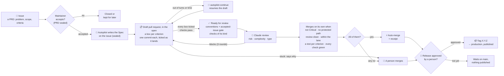
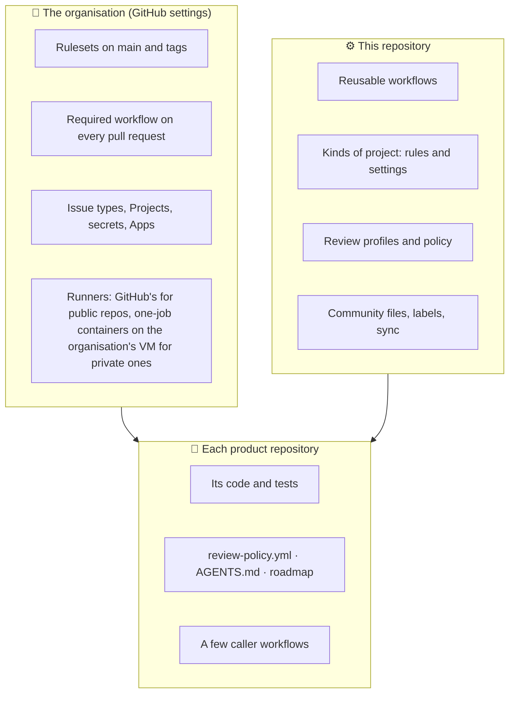

<picture>
  <source media="(prefers-color-scheme: dark)" srcset="profile/diluxone-isologo-horizontal-fondo-oscuro.svg">
  
</picture>

# DiluxOne/.github

**How every DiluxOne repository is checked, reviewed, merged and released, written once, here.**

Each repository calls the workflows in this one instead of carrying its own copy, and inherits its community files (contributing guide, security policy, issue forms, pull request template). Change a rule here and every repository follows it.

| 🎫 No issue, no code | 🔍 Checked and reviewed | 🚦 Nothing merges red |
| --- | --- | --- |
| Every pull request closes an issue a maintainer accepted. A paid or already planned feature is stopped there, before anyone writes it. | Deterministic checks for the kind of project, then a Claude review that labels risk and complexity and comments on what blocks. | Rulesets require every check. A change merges on its own only when it touches low-risk paths alone, the review rates it low risk and low complexity, nothing blocks, its author is trusted and every check is green. Anything else waits for a person, and every release waits for a person's approval. |

## The life of a change

You can follow an autopilot run as it goes: its draft pull request is the Spec as a checklist, one box per criterion, ticked as each criterion's commit lands; the issue's board links the pull request, the run and the progress; the run's summary says what the agent read, ran and changed, and keeps its full transcript. A run never ends in silence: the pull request is ready for review, or the agent says where it stopped and why, or the run continues (`autopilot:continue`), or the workflow says so and hands it to a person (`needs-human`). A pull request that is not the autopilot's, a person's or a contributor's, joins the same path at "Ready for review".

Step by step, with every detail: [What happens on a pull request](docs/pull-requests.md).

## Who holds what

## The rules in one minute

- **Conventional Commits** for branches, titles and commits. CI rejects anything else.
- **One accepted issue per pull request.** Bots' pull requests (Dependabot, releases) are the exception.
- **Every accepted issue has an owner.** Whoever accepts it is its assignee, until a member of the organisation opens the pull request that closes it; a bot never is.
- **Autonomy is data too, and only ever narrower.** What may proceed without a person comes from [`policy/autonomy.yml`](policy/autonomy.yml): named lanes, each checked against GitHub, never against an issue's text. A repository can only tighten it, the rules that govern it always need a person, and `DX_AUTOPILOT=off` stops it all.
- **Policy is data.** Risk paths, models, budget and auto-merge live in [`policy/`](policy/) and in each repository's `.github/review-policy.yml`, read from the base branch, so a pull request cannot loosen its own rules.
- **A review lesson becomes a rule.** Something a reviewer sent back once becomes one entry in its kind's `rules.yml`, with fixtures, never a new script ([`kinds/`](kinds/)).
- **Secrets never meet a fork's code.** Actions are pinned to a commit and every token asks for the least it needs.
- **Every job starts clean.** Public repositories run on GitHub's runners; private ones on the organisation's VM, each job in a disposable container of an image rebuilt and smoke-tested every week ([`runner/`](runner/)).
- **Every pending step names its action and its URL.** Agents tell a maintainer exactly what to accept, approve or merge, with the link; an outside contributor is never asked for a maintainer's step.
- **Versions are tags.** Repositories call `@v5`. A breaking change ships as `v6`, and older majors stay where they are.

## What's inside

| | Folder | What it holds |
| --- | --- | --- |
| ⚙️ | [`.github/workflows/`](.github/workflows/) | The reusable workflows and the organisation's required pull request pipeline |
| 🧩 | [`kinds/`](kinds/) | One pack per kind of project (today, `wordpress-plugin`): its rules, review profile and settings |
| 📜 | [`policy/`](policy/) | The default review policy every repository adds to |
| 🤖 | [`review-profiles/`](review-profiles/) | What the Claude review looks for |
| 🛠️ | [`scripts/`](scripts/) | The logic behind the workflows, each script with its own `--test`; [`scripts/runner-vm/`](scripts/runner-vm/) keeps the organisation's VM in its described state |
| 🏃 | [`runner/`](runner/) | The image every job on the organisation's VM runs in, `ghcr.io/diluxone/runner` |
| 📋 | [`workflow-templates/`](workflow-templates/) | Ready-made callers for a new repository |
| 🏷️ | [`labels.yml`](labels.yml) · [`repos.yml`](repos.yml) | Labels, settings and Projects, kept in step by `scripts/sync-repos.py` |
| 🖼️ | [`profile/`](profile/) | The organisation's public page on GitHub |

## Read more

| If you want to… | Read |
| --- | --- |
| Contribute to any DiluxOne repository | [CONTRIBUTING.md](CONTRIBUTING.md) |
| Point an AI agent at a repository | [docs/agents.md](docs/agents.md) |
| Follow a pull request through every step | [docs/pull-requests.md](docs/pull-requests.md) |
| Bring a new repository in | [docs/adopting.md](docs/adopting.md) |
| Move a repository to a newer major | [docs/migrating.md](docs/migrating.md) |
| Look up a workflow, a script, a secret | [docs/workflows.md](docs/workflows.md) |
| Add a rule or a kind of project | [kinds/README.md](kinds/README.md) |
| Change this repository and ship it | [docs/maintaining.md](docs/maintaining.md) |
| Report a security problem | [SECURITY.md](SECURITY.md) |
| See where this is going: one human decision per change, gates, receipts | [The plan, issue #78](https://github.com/DiluxOne/.github/issues/78) |
| Read the story of how we build software | [Cómo construimos software en DiluxOne](https://diluxone.com/es/blog/como-construimos-software/) · [How we build software](https://diluxone.com/blog/how-we-build-software/) |
